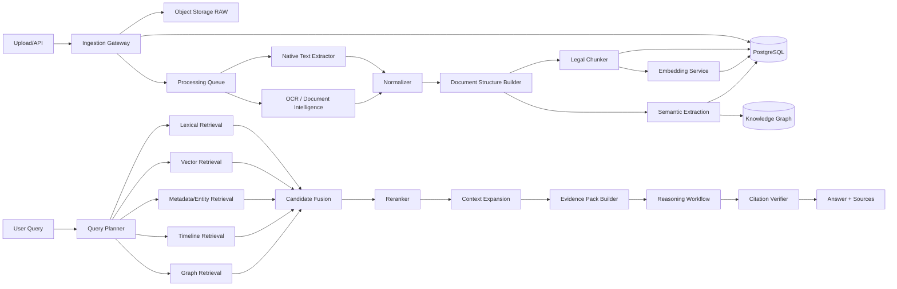

# 01 — Arquitetura do Sistema

## 1. Estilo arquitetural

A solução adota arquitetura modular orientada a domínio, eventos e pipelines assíncronos.

Separação principal:

- Document Plane: arquivos, OCR, layout e proveniência.
- Knowledge Plane: entidades, eventos, claims, evidence graph.
- Retrieval Plane: índices e recuperação multiestágio.
- Reasoning Plane: planejamento, comparação, verificação e síntese.
- Control Plane: segurança, configuração, auditoria e observabilidade.

## 2. Diagrama lógico



## 3. Serviços/módulos

### 3.1 Case Service

Responsável por:
- casos;
- participantes;
- ACL;
- classificação;
- retenção.

Não processa conteúdo.

### 3.2 Ingestion Service

Responsável por:
- upload;
- MIME detection;
- validação;
- hash;
- manifest;
- persistência do original;
- criação de jobs.

### 3.3 Document Processing Service

Responsável por:
- extração nativa;
- OCR;
- layout;
- normalização;
- divisão em páginas/blocos;
- confidence scoring.

### 3.4 Chunking Service

Responsável por:
- segmentação estrutural;
- parent-child relations;
- overlap somente quando justificado;
- geração de spans;
- preparação de conteúdo para indexação.

### 3.5 Embedding Service

Responsável por:
- batching;
- rate limiting;
- cache;
- versionamento de modelo;
- idempotência;
- gravação de embeddings.

### 3.6 Knowledge Extraction Service

Responsável por:
- NER;
- entity mentions;
- candidate identity resolution;
- events;
- claims;
- evidence candidates;
- semantic relations.

### 3.7 Graph Service

Responsável por:
- sincronização do modelo relacional para o grafo;
- traversal;
- subgraph retrieval;
- path explanation;
- graph versioning.

### 3.8 Retrieval Service

Responsável por:
- lexical;
- dense;
- metadata;
- timeline;
- graph;
- fusion;
- reranking;
- context expansion.

### 3.9 Evidence Pack Service

Responsável por transformar resultados recuperados em um contrato explícito e versionado para o Reasoning Plane.

### 3.10 Reasoning Service

Executa workflow controlado de:
- decomposição;
- comparação;
- corroboração;
- contradição;
- síntese;
- verificação.

### 3.11 Citation Service

Valida se afirmações da resposta são suportadas pelo span citado.

### 3.12 Audit Service

Registra:
- ações do usuário;
- processamento;
- retrieval;
- prompts;
- modelos;
- resposta;
- decisões humanas.

## 4. Dependências permitidas

Domínio não depende de SDKs externos.

Interfaces de provider pertencem à application layer.

Implementações de PostgreSQL, S3, Neo4j, OCR e LLM pertencem à infrastructure layer.

Regra recomendada:

`domain <- application <- adapters/infrastructure <- interfaces/api`

## 5. Organização sugerida do código

```text
src/
  graphrag_investigations/
    domain/
      cases/
      documents/
      entities/
      events/
      claims/
      evidence/
      retrieval/
    application/
      commands/
      queries/
      workflows/
      ports/
    infrastructure/
      postgres/
      object_storage/
      vector/
      graph/
      ocr/
      llm/
      embeddings/
      reranking/
      messaging/
      observability/
    interfaces/
      api/
      workers/
      cli/
    shared/
      config/
      logging/
      security/
      errors/
```

## 6. Comunicação

Sincrona:
- API de consulta;
- CRUD administrativo;
- retrieval interativo.

Assíncrona:
- ingestão;
- OCR;
- embeddings;
- extraction;
- graph sync;
- reindexação.

## 7. Event-driven processing

Eventos mínimos:
- `SourceFileIngested`
- `DocumentNormalized`
- `DocumentStructured`
- `ChunksCreated`
- `EmbeddingsGenerated`
- `SemanticExtractionCompleted`
- `GraphProjectionUpdated`
- `CaseIndexReady`

Cada evento deve possuir:
- event_id;
- aggregate_id;
- case_id;
- occurred_at;
- schema_version;
- correlation_id;
- causation_id.

## 8. Idempotência

Jobs devem usar chave:
`{artifact_id}:{pipeline_stage}:{processor_version}:{config_hash}`.

Se já houver resultado válido para essa chave, o stage pode retornar o artefato existente.

## 9. Consistência

PostgreSQL é o System of Record para metadados e objetos semânticos.

Object Storage é o System of Record para bytes e artefatos derivados.

Graph DB é projeção consultável, reconstruível a partir do System of Record.

Vector index também é reconstruível.

## 10. Decisão importante

Nenhum componente analítico deve confiar em conteúdo gerado por LLM sem:
- `source_span_id`;
- confidence;
- extraction_run_id;
- revisão humana quando exigida pela política.
