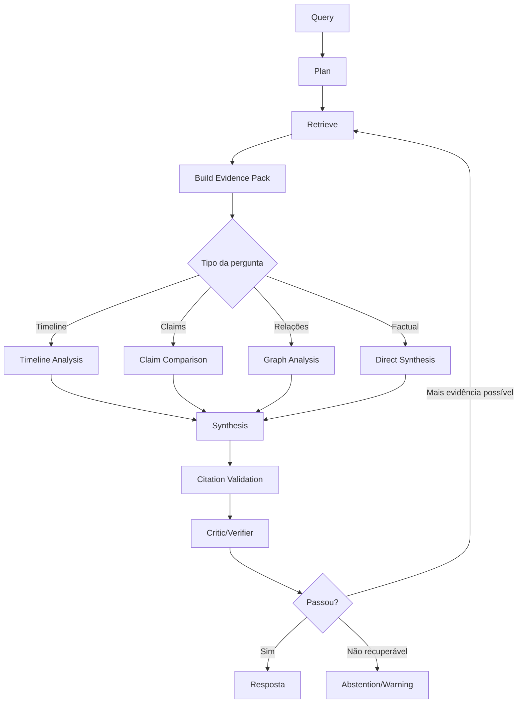

# 05 — Agentes, LLMs e Reasoning

## 1. Princípio

LLMs não são System of Record. Eles executam tarefas de interpretação e raciocínio sobre dados recuperados e rastreáveis.

O sistema deve privilegiar workflows determinísticos com passos explícitos, limites e critérios de parada.

## 2. Papéis

### Query Planner
Entrada: pergunta, contexto autorizado e metadados do caso.
Saída: query_type, subqueries, retrievers necessários, filtros e estratégia de resposta.
Não responde ao usuário.

### Entity Resolution Agent
Entrada: menções, candidatos e contexto documental.
Saída: resolved, ambiguous, rejected candidates, confidence e referências.
Não pode fundir entidades abaixo de threshold sem revisão.

### Evidence Retrieval Agent
Orquestra canais de retrieval conforme o plano. Não interpreta evidência como verdadeira ou falsa.

### Timeline Agent
Constrói sequência temporal com eventos ordenados, intervalos incertos, conflitos e lacunas.

### Claim Comparison Agent
Compara claims por subject, predicate, object, polarity, modality e temporal scope.

### Contradiction Agent
Detecta incompatibilidade sem concluir automaticamente mentira ou fraude. Deve retornar claims/evidências, tipo de contradição, rationale, confidence e spans.

### Corroboration Agent
Busca suporte independente e distingue repetição da mesma fonte de evidência realmente independente.

### Legal Analysis Agent
Somente quando habilitado. Deve separar fato documental, alegação, inferência, norma citada, interpretação jurídica e conclusão provisória.

### Synthesis Agent
Produz resposta a partir do Evidence Pack.

### Citation Validator
Para cada afirmação: identifica claim, mapeia evidência citada, verifica suporte e sinaliza/rejeita citação fraca.

### Critic/Verifier
Procura conclusão não suportada, fonte omitida, evidência contrária ignorada, overclaim e ambiguidade.

## 3. Orquestração

Recomendado: State Machine/Workflow Engine com estados persistidos, timeout, retry policy, budget por etapa e número máximo de iterações.

Limitar loop de nova recuperação.

## 4. Provider abstractions

Interfaces mínimas:
- LLMProvider
- EmbeddingProvider
- RerankerProvider
- VisionProvider
- SpeechToTextProvider

Configuração por tarefa:
- extraction model
- reasoning model
- verification model
- vision model

## 5. Structured outputs

Toda tarefa intermediária deve preferir schema estruturado validado por Pydantic/JSON Schema.

Se output não validar: retry controlado, fallback ou falha explícita.

## 6. Prompt management

Prompts são artefatos versionados. Registrar:
- prompt_id
- prompt_version
- rendered_prompt_hash
- model
- parameters
- schema_version

## 7. Política de linguagem

Modelos devem:
- não equiparar ausência de evidência a falsidade;
- não chamar alguém de mentiroso com base apenas em inconsistência;
- distinguir citação direta de paráfrase;
- explicitar incerteza;
- mencionar evidência contrária material;
- não extrapolar além das fontes;
- solicitar ou emitir revisão quando identidade estiver ambígua.

## 8. Tool access

Agentes não acessam storage ou banco diretamente. Devem usar application services autorizados:
- retrieve
- get_source_span
- get_document_context
- get_entity
- get_timeline
- get_graph_path

## 9. Memory

Memória conversacional não é evidência.

Contextos:
- session context: histórico da interação;
- case context: dados recuperados;
- evidence context: Evidence Pack.

Somente evidence context sustenta afirmações factuais sobre o caso.

## 10. Critérios de aceite

- nenhum agente pode ignorar ACL;
- output intermediário possui schema;
- análise final passa por citation validation em níveis de alta confiança;
- loops possuem limite;
- erros e fallbacks são auditados;
- prompts e modelos são reproduzíveis.
